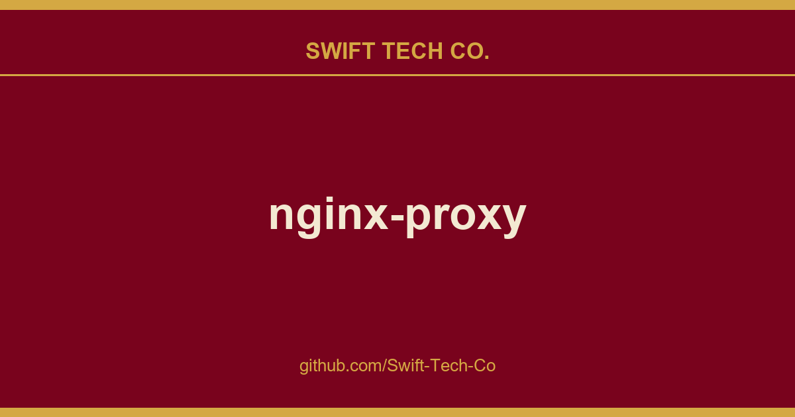

# nginx-proxy

## What This Is

We keep a working index for product and engineering, and nginx-proxy is the entry that collects our notes, examples and fixes. It reflects how Swift Tech Co. actually uses this in builds and client work.

## Images

## About this repository
> [!NOTE]
> We welcome contributions and feedback from the community!  
> For more information about our services, including free and paid SSL/TLS certificates, visit https://www.swifttechco.com

	<a href="https://www.swifttechco.com">
		<picture>
			<source media="(prefers-color-scheme: dark)" srcset="https://www.swifttechco.com">
			<source media="(prefers-color-scheme: light)" srcset="https://www.swifttechco.com">
			
		</picture>
	</a>

---

## Swift Tech Co.

Built and maintained by Swift Tech Co.

AI Automation | FinTech Platforms | Custom Software and Mobile Apps | SaaS Platforms | Cloud Infrastructure | Cybersecurity | SEO and Marketing | API Integration

**Join our community on Telegram:** [t.me/+Qt_eFvkb2rliMzNh](https://t.me/+Qt_eFvkb2rliMzNh)

Home | Services | Careers | Referral Program | Influencers | About | Contact

**Connect**

- Website: swifttechco.com
- LinkedIn: [linkedin.com/in/stephenoladoke](https://www.linkedin.com/in/stephenoladoke/)
- LinkedIn (Company): [linkedin.com/company/swift-tech-co](https://www.linkedin.com/company/swift-tech-co)
- X: [@MrOladoke](https://x.com/MrOladoke)
- Instagram: [@mr.oladoke](https://www.instagram.com/mr.oladoke/)
- Instagram (Company): [@swifttechco](https://www.instagram.com/swifttechco/)
- Organization: [github.com/Swift-Tech-Co](https://github.com/Swift-Tech-Co)

## Sources

Compiled and maintained from upstream [nginx-proxy/nginx-proxy](https://github.com/nginx-proxy/nginx-proxy) under permissive open-source license.

---

Maintained by [Swift Tech Co.](https://github.com/Swift-Tech-Co) - [Telegram](https://t.me/+Qt_eFvkb2rliMzNh)